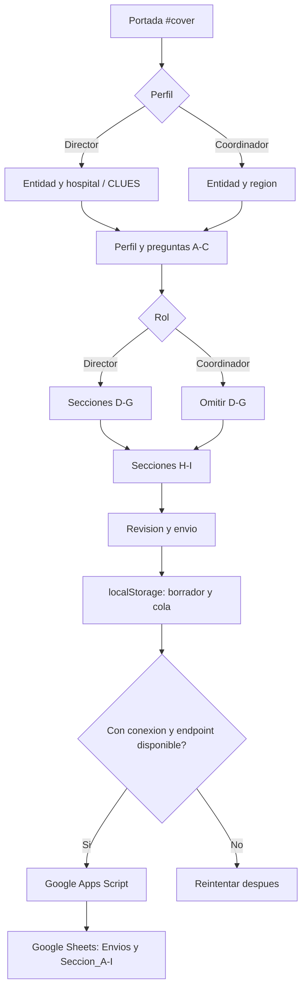
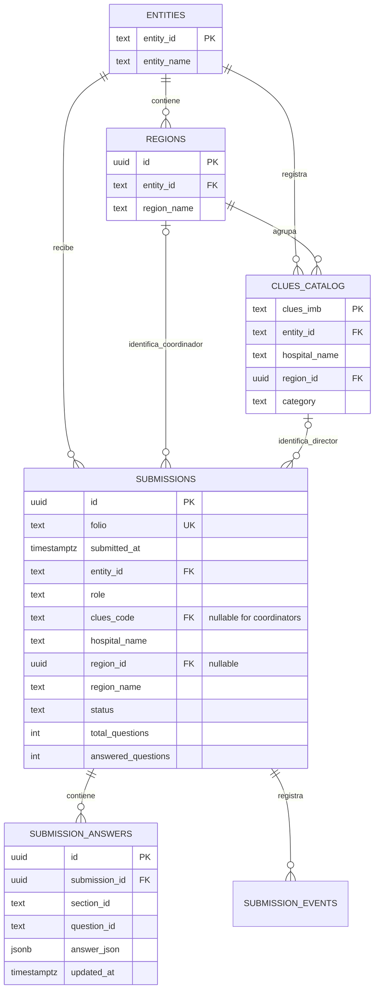
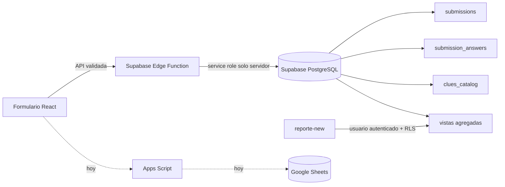

# Cuestionario hospitalario

Guia de mantenimiento del cuestionario para personal directivo hospitalario y de coordinacion regional, de su escritura en Google Sheets y del reporte que lo acompana.

## Repositorios y alcance

El workspace contiene dos repositorios Git independientes:

| Proyecto | Ruta de trabajo | Responsabilidad | Publicacion |
| --- | --- | --- | --- |
| Formulario | raiz de este repositorio | Cuestionario, validacion, guardado local, sincronizacion con Apps Script | `https://servicios-imss-b.github.io/cuestionario-hospitales/` |
| Reporte de infraestructura | `new-form/reporte-new/reporte-_angeles/` | Dashboard de infraestructura, avance y faltantes | `https://servicios-imss-b.github.io/reporte-new/` |

`new-form/reporte-new/reporte-_angeles/` tiene su propio `.git` y remoto. No se agrega desde el repositorio del formulario. Sus JSON, notebooks y archivos de `docs/` pueden contener cambios locales: revisalos antes de hacer commit o compilar.

El dashboard de `reporte-new` actualmente carga archivos JSON estaticos de `public/` y `informe--de-ang/data.js`. No lee todavia las respuestas del cuestionario de Google Sheets. La pestaña **Informe de clues pendientes** contiene actualmente las tablas de infraestructura; su ubicacion no cambia la fuente de datos.

## Inicio local

Requisitos: Node.js 22 o compatible con Vite 8.

```powershell
npm install --legacy-peer-deps
npm run dev
```

Comprobaciones del formulario:

```powershell
npm run lint
npm run build
```

El formulario se sirve normalmente en `http://localhost:3000/`. Su ruta inicial es `#cover`; al refrescar siempre debe volver a esa portada.

Para trabajar en el reporte, usa su propio directorio y dependencias:

```powershell
cd new-form/reporte-new/reporte-_angeles
npm ci
npm run dev
npm run typecheck
```

**Precaucion del reporte:** `vite.config.ts` configura `build.outDir: 'docs'` y `emptyOutDir: true`. `npm run build` puede borrar primero el contenido existente de `docs/`. Hay datos y artefactos versionados alli; no compiles sin respaldarlos y revisar `git status`.

## Flujo funcional



La seleccion de rol esta en la portada, no es una pregunta del catalogo. La identidad institucional se solicita despues: directores seleccionan CLUES y coordinadores seleccionan region. Ambos responden B, C, H e I; D-G solo se activa para directores. Las preguntas con condiciones (por ejemplo, otra respuesta, equipos fuera de servicio o ambulancias) solo aparecen cuando corresponde.

Una respuesta se conserva primero en el navegador. La cola pendiente se reintenta cuando el dispositivo tiene red y Apps Script responde. El folio es la llave usada para actualizar una respuesta existente, no para duplicarla.

## Donde cambiar el formulario

| Cambio deseado | Archivo o simbolo | Que debe mantenerse sincronizado |
| --- | --- | --- |
| Texto, opciones, obligatoriedad, seccion o saltos | `src/data/questions.ts`, `QUESTIONS_CATALOG` | IDs estables, `sectionId`, `appliesToRoles`, `condition`, texto regional, opciones y reglas de validacion |
| Aspectos de la matriz C1 | `MATRIX_C1_DIRECTOR_ITEMS`, `C2_OPTIONS` en `src/data/questions.ts` | Mantener los mismos IDs para C1, C2 y C3; el reporte y las cabeceras de Sheets usan esos IDs |
| Tipo de control nuevo | `src/types/questionnaire.ts`, `src/components/questionnaire/CaptureTable.tsx`, `src/components/questionnaire/QuestionControls/`, `src/utils/validation.ts` | Agregar el tipo, el control de captura y su validacion; un tipo nuevo no se resuelve cambiando solo el texto |
| Edad y limites numericos | `src/data/questions.ts` pregunta A3 y `src/utils/validation.ts` | A3 se almacena exacta; hoy valida entero de 25 a 80. Sheets usa `edad_anios_exacta` |
| Lista de hospitales, CLUES, entidades o regiones | `src/data/notebook-clues.json`, `src/data/notebookCatalog.ts` | Cada registro necesita `clues_imb`, `entidad`, `nombre_de_la_unidad`, `nombre_region`; las regiones salen del catalogo filtrado por entidad |
| Guardado sin red y cola pendiente | `src/services/storage.ts` | Claves `imss_bienestar_survey_draft` y `imss_bienestar_survey_submissions`; los folios pendientes no deben descartarse al fallar la red |
| Payload y conexion a Google Sheets | `src/services/googleSheets.ts`, `App.tsx` (`buildSubmissionSnapshot`, `groupAnswersBySection`) | Mantener `submissionId`, entidad, perfil, region/CLUES, estado y `answersBySection` |
| Pestanas, encabezados y escritura en Sheets | `apps-script/Code.gs` | Actualizar `SECTION_SHEETS`, encabezados y alias de columnas cuando cambie el catalogo |
| Graficas, datos y tablas del reporte | `new-form/reporte-new/reporte-_angeles/src/App.tsx`, `src/data.ts`, `src/types.ts` | Actualmente consumen JSON publicados, no la hoja de respuestas del cuestionario |

### Catalogo de preguntas actual

Los IDs son contratos de datos. Renombrar el texto es compatible; cambiar/eliminar un ID requiere migrar cabeceras y datos historicos.

| Seccion | IDs actuales | Aplicacion y condiciones importantes |
| --- | --- | --- |
| A. Perfil | `A3`, `A4`, `A5`, `A5_otro`, `A6`, `A7`, `A7a`, `A7a_otro`, `A7b` | A3 edad exacta; `A7a`, `A7a_otro`, `A7b` solo director. Region/CLUES y rol se capturan antes, no aqui |
| B. Situacion general | `B1`-`B3` | Ambos roles; cambia la redaccion para hablar de la region |
| C. Comparacion | `C1`-`C6`, `C4_otro` | Ambos roles; matriz C1 aleatoria; C4_otro depende de `Otro`; C5 depende de una respuesta distinta a `Ninguno` |
| D. Fondo rotatorio | `D1`-`D3` | Solo directores; D1 incluye monto condicional hasta $5,000,000 |
| E. Personal | `E1`-`E5` | Solo directores; E4 es matriz numerica; E5 aparece si E4 registra especialistas mayores a cero |
| F. Equipo electromecanico | `F1`-`F7` | Solo directores; F4-F5 dependen de F3; F7 depende de que F6 sea mayor a cero |
| G. Traslado | `G1`-`G8`, `G3_otro`, `G7_otro` | Solo directores; G2-G6 dependen del numero/estado de ambulancias; textos “Otra” son condicionales |
| H. Valoracion | `H1`-`H2` | Ambos roles; abiertas opcionales |
| I. Cierre | `I1` | Ambos roles; abierta opcional, maximo 300 caracteres |

Tipos admitidos en `QuestionType`: `single`, `multiple`, `number`, `short_text`, `long_text`, `matrix`, `number_matrix`, `ranked_select` y `amount_conditional`. La validacion comun esta en `src/utils/validation.ts`; para nuevas condiciones se usa `condition(answers)` en el catalogo.

## Google Sheets actual

La hoja se define por `SPREADSHEET_ID` en `apps-script/Code.gs`. El endpoint del formulario es `VITE_GOOGLE_SHEETS_ENDPOINT`. En local se configura en `.env.local`; el workflow principal tambien define el endpoint para el build publicado.

`googleSheetsService.checkConnection()` hace un `GET` JSONP `action=health` y envia el esquema de preguntas. `sendSubmission()` envia el payload por un formulario oculto/iframe; Apps Script devuelve el resultado con `postMessage`. El script serializa valores compuestos como JSON en una celda y hace upsert por folio.

### Pestana `Envios`

| Columna | Tipo/ejemplo | Significado |
| --- | --- | --- |
| `folio` | texto `IMSSB-...` | Llave primaria logica del envio; permite upsert |
| `fecha_envio` | ISO-8601 | Fecha de guardado/envio |
| `clues_imb` | texto | CLUES para director; vacia en coordinador |
| `entidad` | texto | Entidad federativa |
| `nombre_de_la_unidad` | texto | Hospital para director; `Coordinacion regional` para coordinador |
| `perfil` | `director` / `coordinador` | Ruta elegida en la portada |
| `preguntas_total` | entero | Preguntas activas en la ruta |
| `preguntas_respondidas` | entero | Preguntas validadas/respondidas |
| `region` | texto | Region asociada a la unidad o coordinacion |
| `estado` | `Borrador` / `Completado` | Situacion de sincronizacion del cuestionario |

### Pestanas `Seccion_A` a `Seccion_I`

Cada pestana tiene `folio` como primera columna y una columna por ID de pregunta activo. El esquema enviado desde el frontend agrega cabeceras nuevas al detectar cambios. Los valores de matriz, multi-seleccion y otros objetos se guardan como JSON en una celda.

| Pestana | Grupo | IDs almacenados |
| --- | --- | --- |
| `Seccion_A` | Perfil | `A3`, `A4`, `A5`, `A5_otro`, `A6`, `A7`, `A7a`, `A7a_otro`, `A7b` |
| `Seccion_B` | Situacion | `B1`, `B2`, `B3` |
| `Seccion_C` | Comparacion | `C1`, `C2`, `C3`, `C4`, `C4_otro`, `C5`, `C6` |
| `Seccion_D` | Fondo rotatorio | `D1`, `D2`, `D3` |
| `Seccion_E` | Personal | `E1`-`E5` |
| `Seccion_F` | Equipo | `F1`-`F7` |
| `Seccion_G` | Traslado | `G1`-`G8`, `G3_otro`, `G7_otro` |
| `Seccion_H` | Valoracion | `H1`, `H2` |
| `Seccion_I` | Cierre | `I1` |

La pregunta A3 guarda el numero exacto y usa la cabecera `edad_anios_exacta`. Esa columna es sensible: para presentaciones se debe derivar edad por rangos y no cruzarla con hospital ni sexo. Limita el acceso a la hoja original.

## Cambiar CLUES y entidades

1. Actualiza el origen de datos `src/data/notebook-clues.json`; no edites el catalogo derivado dentro de `notebookCatalog.ts`.
2. Conserva un registro por unidad con las cuatro propiedades `clues_imb`, `entidad`, `nombre_de_la_unidad`, `nombre_region`.
3. `notebookCatalog.ts` normaliza nombres para IDs, construye `MEXICAN_ENTITIES`, transforma filas en CLUES y deriva la lista de regiones.
4. Revisa duplicados de CLUES y regiones con variaciones de acentos/espacios antes de publicar.
5. No reemplaces una CLUES historica sin una tabla de equivalencias si ya hay respuestas asociadas.

## Reporte `reporte-new`

El reporte es un repositorio Git separado en `new-form/reporte-new/reporte-_angeles/`. Actualmente `src/data.ts` hace `fetch` de JSON relativos a `BASE_URL`:

| Recurso | Uso actual |
| --- | --- |
| `public/base_clues.json` | Catalogo/base de CLUES esperadas |
| `public/base_meta.json` | Totales y fecha de actualizacion |
| `public/clues_geo.json` | Coordenadas y datos para mapas |
| `public/base_an.json` | Base cruda del reporte |
| `public/resultado.json` | Resultado por CLUES |
| `public/resumen.json` | Resumen por unidad |
| `public/resumen_entidad.json` | Resumen por entidad |
| `public/faltantes.json` | Unidades/campos pendientes |
| `informe--de-ang/data.js` | Tablas del tablero de avance |

Las pestañas principales se definen en `src/App.tsx`: **Infraestructura y Materiales**, **Tablero de avance** e **Informe de clues pendientes**. Los subtabs/tablas usan `DataTable` y exportan Excel con `xlsx`. La ubicacion actual de esas tablas es la pestaña de pendientes; sus fuentes siguen siendo los JSON anteriores.

El workflow `new-form/reporte-new/reporte-_angeles/.github/workflows/deploy-pages.yml` compila en `main` y publica `docs/`. Para desarrollar, usa `npm run dev`; `npm run typecheck` no modifica archivos. Evita `npm run build` mientras haya cambios locales en `docs/`, porque Vite lo vacia antes de recrearlo.

## Migracion propuesta a Supabase

`@supabase/supabase-js` ya esta en las dependencias del reporte, pero actualmente **no hay cliente Supabase implementado**. La migracion debe sustituir la lectura de JSON en `reporte-new/src/data.ts` y la escritura de Apps Script en `src/services/googleSheets.ts`; instalar la libreria por si sola no conecta nada.

### Modelo de datos recomendado

| Tabla Supabase | Columnas principales | Proposito |
| --- | --- | --- |
| `submissions` | `id uuid PK`, `folio text UNIQUE`, `submitted_at timestamptz`, `entity_id text FK`, `role text`, `clues_code text NULL FK`, `hospital_name text`, `region_id uuid NULL FK`, `region_name text NULL`, `status text`, `total_questions int`, `answered_questions int` | Una fila por folio, equivalente a `Envios`; CLUES es nula para coordinadores |
| `submission_answers` | `id uuid PK`, `submission_id uuid FK`, `section_id text`, `question_id text`, `answer_json jsonb`, `updated_at timestamptz`, `UNIQUE(submission_id, question_id)` | Respuestas normalizadas; matrices y multiseleccion caben en JSONB |
| `entities` | `entity_id text PK`, `entity_name text` | Catalogo de entidades |
| `regions` | `id uuid PK`, `entity_id text FK`, `region_name text` | Regiones seleccionables por entidad |
| `clues_catalog` | `clues_imb text PK`, `entity_id text FK`, `hospital_name text`, `region_id uuid FK`, `category text NULL` | Catalogo de hospitales y sus CLUES |
| `submission_events` (opcional) | `id uuid PK`, `submission_id uuid FK`, `event_type text`, `created_at timestamptz`, `details jsonb` | Auditoria de borrador, completado y sincronizacion |



Las matrices mantienen sus IDs de renglón dentro de `answer_json`; por ejemplo, `C1` es un objeto `{"c1_1":"Mejoró", "c1_2":"Igual"}`. La edad A3 debe guardarse como numero entero exacto restringido a 25-80; vistas de reporte deben exponer solo rangos para usuarios que no necesitan el valor exacto.

### Secuencia de migracion

1. Crear migraciones SQL para tablas, indices, constraints y vistas. Usar `folio` como clave unica y `(submission_id, question_id)` para upsert de respuestas.
2. Cargar `notebook-clues.json` a `clues_catalog` y definir la relacion de hospitales/regiones.
3. Habilitar RLS. Lectura del reporte solo para usuarios autenticados con rol autorizado; escritura del cuestionario solo mediante una Edge Function/API validada. Nunca guardar `service_role` en `VITE_*` ni en el navegador.
4. Implementar el cliente de Supabase en un modulo separado (por ejemplo `src/services/supabase.ts`) usando `VITE_SUPABASE_URL` y `VITE_SUPABASE_ANON_KEY`; la anon key no reemplaza RLS.
5. Reemplazar `googleSheetsService.checkConnection/sendSubmission` por un adaptador con el mismo contrato o una cola equivalente. Mantener respaldo local y reintento idempotente por folio.
6. Cambiar `reporte-new/src/data.ts` para consultar vistas de reporte y paginar/filtrar desde servidor. Eliminar JSON estaticos solo despues de verificar conteos, CLUES, fechas y agregados contra la fuente anterior.
7. Migrar datos historicos con un script repetible e idempotente; reconciliar cantidades por folio antes de cambiar el reporte a la nueva fuente.
8. Publicar primero entorno de prueba, comprobar RLS con usuario anonimo y autenticado, y despues cambiar producción.



### Seguridad y confidencialidad

- El login que se muestra en GitHub Pages es solo una barrera visual: las credenciales en el bundle pueden inspeccionarse y no protegen JSON publicados en `public/`.
- El endpoint de Apps Script publicado como “cualquier usuario” puede recibir solicitudes no deseadas. Antes de guardar datos sensibles, agregar autenticacion/validacion en servidor y restricciones de acceso.
- No subir service keys, tokens ni archivos `.env.local`. Las variables `VITE_*` quedan visibles para el navegador; solo la anon key de Supabase puede llegar al cliente y siempre con RLS.
- Edad exacta, hospital y respuestas no deben exponerse en un dashboard publico. Aplicar control de acceso y publicar agregados con reglas de celdas pequenas.

## Librerias

| Proyecto | Libreria | Uso |
| --- | --- | --- |
| Formulario | `react`, `react-dom` | Componentes e interfaz |
| Formulario | `typescript` | Tipos del catalogo, respuestas y payload |
| Formulario | `vite`, `@vitejs/plugin-react` | Servidor de desarrollo y build |
| Formulario | `tailwindcss`, `@tailwindcss/vite` | Estilos |
| Formulario | `motion` | Transiciones de portada, modales y etapas |
| Formulario | `lucide-react` | Iconos |
| Formulario | `clsx`, `tailwind-merge` | Composicion/utilidad de clases |
| Formulario | `@types/node`, `@types/react`, `@types/react-dom` | Tipos de desarrollo |
| Reporte | `react`, `react-dom`, `typescript`, `vite`, `@vitejs/plugin-react` | Interfaz y build del dashboard |
| Reporte | `recharts` | Graficas |
| Reporte | `maplibre-gl`, `react-map-gl` | Mapa interactivo |
| Reporte | `lucide-react` | Iconos |
| Reporte | `xlsx` | Exportacion de tablas a Excel |
| Reporte | `@supabase/supabase-js` | Cliente instalado; aun no conectado al codigo |
| Herramientas | `eslint`, `typescript-eslint` | Lint/typecheck del reporte |

## Despliegue

El formulario se compila y publica desde `.github/workflows/deploy.yml`; la base de Vite debe ser `/cuestionario-hospitales/` en GitHub Actions. En Settings > Pages, la fuente debe ser **GitHub Actions**.

El reporte usa su propio workflow `new-form/reporte-new/reporte-_angeles/.github/workflows/deploy-pages.yml`, publica el directorio `docs` y su URL es `https://servicios-imss-b.github.io/reporte-new/`.

Tras cada cambio, revisar el `git status` de ambos repositorios por separado. En el del reporte, no incluir JSON/notebooks/datos locales salvo que ese sea el cambio solicitado expresamente.
